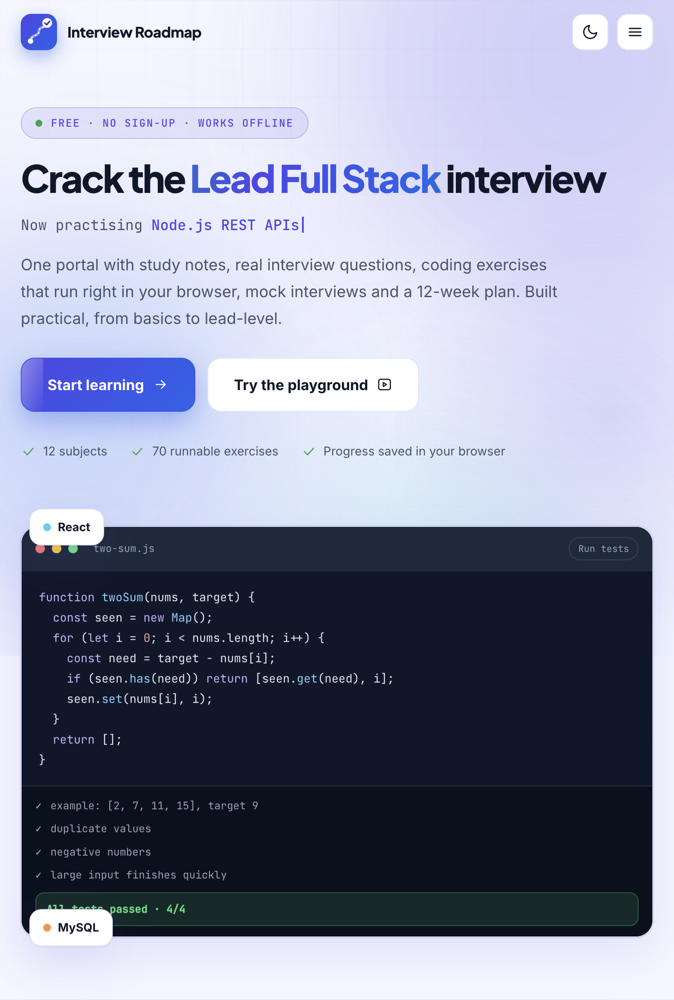

# Interview Roadmap

A free, interactive interview-prep portal for Lead Full Stack engineers: study notes, interview Q&A, runnable coding exercises, a mock-interview module and a 12-week plan.

- **412** study notes, **409** interview questions, **163** exercises (70 runnable with automated tests)
- 12 subjects: HTML & CSS, JavaScript, TypeScript, DSA, React, Testing, Node.js, Database, System Design, Deployment, AI-assisted coding, Leadership
- Mock interview: timed rounds, company-style loops, voice answers, follow-ups, readiness report and PDF export
- No build step, no dependencies, no backend. Progress is saved in the browser (`localStorage`).

Built and maintained by **Wishvanath Sah**.

## Live preview

[Open Interview Roadmap](https://wishvanathofficial.github.io/lead-fullstack-interview-prep/)



## Structure

| Path | Purpose |
| --- | --- |
| `index.html` | Landing page |
| `learn.html` | The learning portal (hash-routed single page app) |
| `terms.html` | Terms & Conditions |
| `404.html` | Not-found page used by GitHub Pages |
| `assets/` | CSS, JavaScript, content data and notes, logo |
| `assets/img/landing-page.png` | Landing-page screenshot |
| `tools/check-tests.js` | Verifies every runnable exercise passes against its solution |

## Run locally

Open `index.html` in a browser. Everything works from `file://`. Or serve the folder:

```bash
npx serve .
```

## Check the exercises

```bash
node tools/check-tests.js
```

## Deploy to GitHub Pages

1. Create a new repository on GitHub and push this folder to the `main` branch:

   ```bash
   git init
   git add .
   git commit -m "Initial release"
   git branch -M main
   git remote add origin https://github.com/<your-user>/<repo>.git
   git push -u origin main
   ```

2. In the repository go to **Settings → Pages → Build and deployment → Source** and choose **GitHub Actions**.
3. The included workflow (`.github/workflows/pages.yml`) runs the exercise tests and publishes the site. Your URL will be `https://<your-user>.github.io/<repo>/`.

Prefer no Actions? Choose **Deploy from a branch → main → / (root)** instead. The `.nojekyll` file is already included.

## Notes

- Fonts load from Google Fonts and the support QR code from cdnjs, so those need an internet connection. Everything else works offline.
- Voice input uses the browser Web Speech API (Chrome or Edge).
- If you fork this, update the support/payment section and the owner name in `index.html` and `terms.html`.

## License

All content and code © Wishvanath Sah. All rights reserved unless you add a license file.
